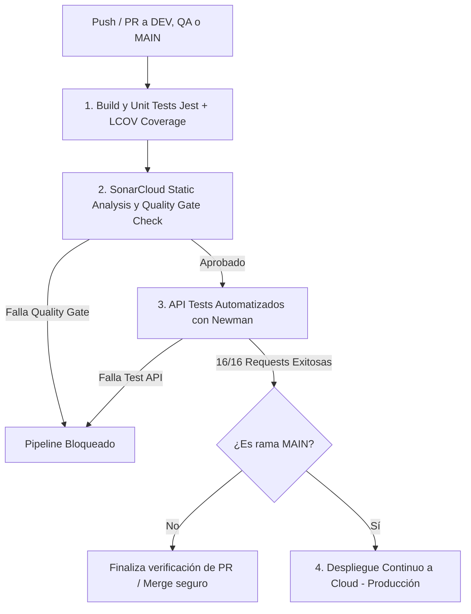

# Documentación del Pipeline CI/CD (Entregable E13)

**Proyecto:** Orders and Products E-Commerce REST API  
**Orquestador:** GitHub Actions  
**Archivo de Definición:** `.github/workflows/ci-cd.yml`  
**Estrategia de Ramas:** DEV, QA y MAIN (PROD)  

---

## 1. Arquitectura y Etapas del Pipeline

El pipeline se ejecuta secuencialmente asegurando que ninguna etapa defectuosa avance al siguiente nivel:

---

## 2. Descripción de Etapas

### Etapa 1: `build-and-test`
* Instala dependencias con `npm ci`.
* Ejecuta las **43 pruebas unitarias y de integración** con Jest.
* Genera la matriz de cobertura de código en formato LCOV (`coverage/lcov.info`).
* Sube los artefactos de cobertura para su posterior análisis.

### Etapa 2: `sonarqube-analysis`
* Descarga el reporte de cobertura de la etapa anterior.
* Ejecuta el escáner de **SonarCloud**.
* Invoca la acción `SonarSource/sonarqube-quality-gate-action`, la cual consulta el estado del Quality Gate en Sonar y **bloquea el pipeline de forma obligatoria** si no se cumple el criterio de aprobación.

### Etapa 3: `api-tests`
* Levanta una instancia en segundo plano del servidor API (`node src/server.js`).
* Valida el healthcheck con `curl`.
* Ejecuta la colección Postman con **Newman** (16 endpoints, 30 aserciones) cubriendo el flujo de negocio completo (auth, creación, inventario, pedidos).
* Exporta los resultados para trazabilidad.

### Etapa 4: `deploy`
* Se activa únicamente si el evento es un push a la rama `main` y todas las etapas previas fueron aprobadas con éxito.
* Despliega la versión verificada hacia el ambiente en Cloud.
